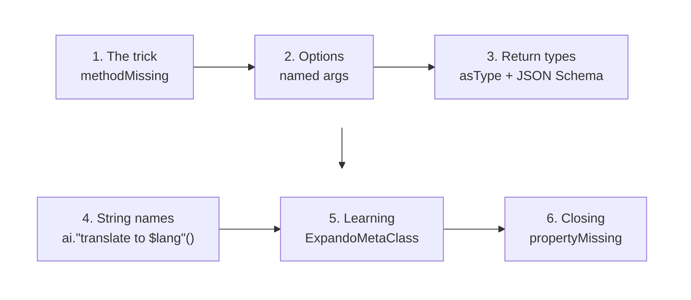
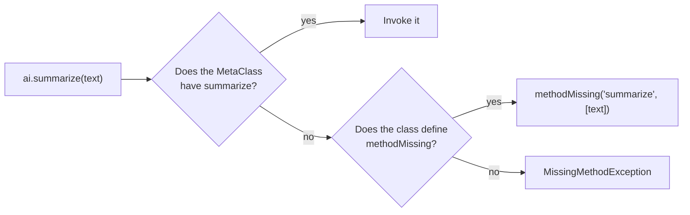
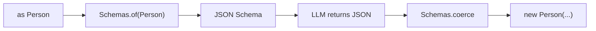
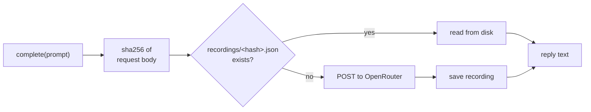

# The Grooviest AI Client

<div class="pt-8">
  <span class="text-2xl opacity-85">
    When <code>methodMissing</code> Meets Large Language Models
  </span>
</div>

<div class="pt-12 text-sm opacity-60">
  Community Over Code &middot; Glasgow &middot; 12 October 2026
</div>

---

# Contact Info

Ken Kousen<br>
Kousen IT, Inc.

- ken.kousen@kousenit.com
- http://www.kousenit.com
- http://kousenit.org (blog)
- Social Media:
  - [@kenkousen](https://twitter.com/kenkousen) (Twitter)
  - [@kousenit.com](https://bsky.app/profile/kousenit.com) (Bluesky)
  - [https://www.linkedin.com/in/kenkousen/](https://www.linkedin.com/in/kenkousen/) (LinkedIn)
- *Tales from the jar side* (free newsletter)
  - https://kenkousen.substack.com
  - https://youtube.com/@talesfromthejarside

---

# The Premise

> What if any method name became an AI prompt?

<v-clicks>

```groovy
def ai = new AI()

println ai.summarize(text)
println ai.translateToFrench(doc)
```

- Neither method exists
- No interface, no annotations, no code generation
- Groovy intercepts the call, the name becomes the instruction, the argument becomes the material

<div class="pt-4 opacity-70">
A confession: this talk was proposed before the code existed.
The core trick takes two minutes. The other 38 are about what happens when you keep pulling the thread.
</div>

</v-clicks>

---

# The Road Ahead



<v-clicks>

- Each step makes the client less of a toy
- Everything you see today runs offline (more on that later)
- Groovy 6.0.0, released 19 September 2026

</v-clicks>

---
layout: section
---

# Part 1: The Two-Minute Trick

---

# How Groovy Dispatches a Method Call



<v-clicks>

- Every Groovy object has a `MetaClass` that owns dispatch
- `methodMissing` is the last stop before the exception
- It receives the **name** as a String and the **arguments** as an `Object[]`
- That String is the whole idea

</v-clicks>

---

# The Whole Idea, in One Method

```groovy
class AI {
    final Closure<String> backend   // (prompt, schema = null) -> reply

    def methodMissing(String name, Object args) {
        List material = args.toList()
        Map options = material && material[0] instanceof Map ? material.remove(0) : [:]
        new Prompt(backend, instruction(name), material, options)
    }

    /** translateToFrench -> "translate to french" */
    static String instruction(String name) {
        name.contains(' ') ? name : name.split(/(?=\p{Upper})/)*.toLowerCase().join(' ')
    }
}
```

<v-clicks>

- `split(/(?=\p{Upper})/)` splits **before** each capital, without consuming it
- The `backend` is just a closure, so tests swap it for a fake
- Nothing is sent yet. `Prompt` is a question that has not been asked

</v-clicks>

---

# Demo 1: The Trick

```groovy
def ai = new AI()

println ai.summarize(text)
println ai.translateToFrench('Groovy makes the JVM fun again.')
println ai.explainLikeImFive('What is metaprogramming?')
```

<v-click>

```text
Apache Groovy is a JVM language with dynamic typing (and optional static typing)
that compiles to Java bytecode and works with any Java library. ...

Groovy redonne du plaisir à la JVM.

Imagine you have a box of LEGOs, and you build things by following instructions.
Now imagine you could build a little robot that builds LEGO things for you...
```

</v-click>

<v-click>

<div class="pt-4 text-center text-xl opacity-80">
That's the talk. Thanks for coming.
</div>

</v-click>

---
layout: section
---

# Part 2: Arguments and Options

---

# Named Arguments Arrive First

```groovy
ai.summarize(text, maxWords: 30, tone: 'pirate')
```

<v-clicks>

Groovy gathers the named arguments into a single `Map` and passes it as the **first** element of `args`:

```groovy
args == [[maxWords: 30, tone: 'pirate'], text]
```

So `methodMissing` peels it off:

```groovy
Map options = material && material[0] instanceof Map ? material.remove(0) : [:]
```

- Positional arguments are the **material**
- Named arguments are the **requirements**
- `args.toList()` rather than `args as List`, because `as List` on an array gives a fixed-size view

</v-clicks>

---

# Rendering the Prompt

```groovy
String render() {
    List lines = ["${instruction.capitalize()}."]
    if (options) {
        lines << 'Requirements:'
        lines.addAll(options.collect { k, v -> "- ${AI.instruction(k)}: $v" })
    }
    lines << 'Reply with only the result, no preamble.'
    if (material) {
        lines << ''
        lines << material.join('\n\n')
    }
    lines.join('\n')
}
```

<v-click>

```text
Summarize.
Requirements:
- max words: 30
- tone: pirate
Reply with only the result, no preamble.

<the talk plan>
```

</v-click>

---

# Demo 2: Requirements

```groovy
println ai.summarize(text, maxWords: 30, tone: 'pirate')

println ai.rewrite('The meeting has been rescheduled.',
                   audience: 'a five-year-old', language: 'Spanish')
```

<v-click>

```text
Arr! Ken Kousen's Groovy talk turns any missing method into an AI prompt,
escalating from a gimmick to typed returns, learning metaclasses, and a
Python bridge. Beware shaky wifi; cache yer replays, matey!

Cambiaron la hora de la reunión. ¡Ahora los grandes se van a juntar en otro momento!
```

</v-click>

---
layout: section
---

# Part 3: Return Types

---

# Nothing Is Sent Until You Look

```groovy
class Prompt {
    private String answer

    String toString() {
        answer ?: (answer = backend(render()))
    }

    def asType(Class type) {
        if (type == String) return toString()
        String json = backend(render(), Schemas.wrap(Schemas.of(type)))
        Schemas.coerce(new JsonSlurper().parseText(json).result, type)
    }
}
```

<v-clicks>

- `println prompt` calls `toString()` and asks for text
- `prompt as LocalDate[]` calls `asType(LocalDate[])` and asks for JSON
- **The type you coerce to decides the shape of the question**
- The answer is memoized, so printing twice costs one call

</v-clicks>

---

# How `as` Works

```groovy
def dates = ai.extractDates(text) as LocalDate[]
```

<v-clicks>

- Groovy compiles `x as T` to a dynamic call of `x.asType(T)`
- If your class defines `asType(Class)`, it wins over the built-in conversions
- You've used this every time you wrote `[1, 2, 3] as Set`
- Here it becomes a **request for structured output**



</v-clicks>

---

# JSON Schema from a Type

```groovy
static Map of(Class type) {
    switch (type) {
        case [int, Integer, long, Long, short, Short, byte, Byte, BigInteger] -> [type: 'integer']
        case [double, Double, float, Float, BigDecimal]                      -> [type: 'number']
        case [boolean, Boolean]                                             -> [type: 'boolean']
        case [LocalDate]                                                    -> [type: 'string', format: 'date']
        case { it.isArray() }   -> [type: 'array', items: of(type.componentType)]
        case { it.isEnum() }    -> [type: 'string', enum: type.enumConstants*.name()]
        case { it.isRecord() }  -> recordSchema(type)
        default                 -> [type: 'string']
    }
}
```

<v-clicks>

- A **list** case means "is one of these"; a **closure** case is a predicate
- `case LocalDate` alone would test `isInstance`, which is wrong for a `Class` value
- Records supply their own schema through `getRecordComponents()`

</v-clicks>

---

# Demo 3: Real Objects Back

```groovy
record Person(String name, String role, LocalDate birthday) {}
enum Sentiment { POSITIVE, NEGATIVE, NEUTRAL }

LocalDate[] dates = ai.extractDates(bio) as LocalDate[]
Person ken       = ai.extractPerson(bio) as Person
Sentiment mood   = ai.classifySentiment('Conference wifi failed again.') as Sentiment
int count        = ai.countTheNumberOfDistinctCities(bio) as int
```

<v-click>

```text
Dates: [MONDAY, MONDAY, TUESDAY]
Record: Person[name=Ken Kousen, role=President of Kousen IT, Inc., birthday=1962-04-09]
Age at the talk: 64
Mood: NEGATIVE
Cities: 1
```

</v-click>

<v-click>

<div class="pt-2 opacity-80">
This is where it stops being a toy. The compiler knows the types, the tests know the types, and the model is just a backend.
</div>

</v-click>

---

# A Teaching Moment: Erasure

```groovy
def dates = ai.extractDates(bio) as List<LocalDate>
println dates*.getClass()*.simpleName
```

<v-click>

```text
[String, String, String]
```

</v-click>

<v-clicks>

- `as List<LocalDate>` compiles to `asType(List)`. The element type is gone
- The best schema we can ask for is an array of strings
- Arrays keep their component type: `LocalDate[].componentType == LocalDate`
- **Prefer `as LocalDate[]`** when you want typed elements back

</v-clicks>

---
layout: section
---

# Part 4: String Method Names

---

# Methods Can Have Any Name

```groovy
println ai."translate to Scots Gaelic"(line)

def language = 'German'
println ai."translate to $language"(line)

println ai."rewrite as a limerick about Glasgow"(line)
```

<v-clicks>

- Groovy allows a quoted String, or a GString, as a method name
- `methodMissing` receives it verbatim, spaces and all
- Almost nobody outside the Groovy community knows this works
- It's a better prompt surface than camelCase

</v-clicks>

---

# Demo 4: Output

```text
Is e an dòigh as fheàrr air an àm ri teachd a ro-innse a chruthachadh.

Der beste Weg, die Zukunft vorherzusagen, ist, sie zu erfinden.

A clever young lad from Glasgow
Said, "Waiting won't help futures grow.
Don't guess what's in store,
Just knock down the door,
And invent it yourself, don't you know!"
```

<v-click>

<div class="pt-6 opacity-80">
The only change in <code>AI.instruction()</code>: if the name already has spaces, leave it alone.
</div>

</v-click>

---
layout: section
---

# Part 5: Learning

---

# ExpandoMetaClass: Teach It a Real Method

```groovy
println ai.respondsTo('summarize') as boolean    // false
println ai.summarize(text)                        // via methodMissing

ai.metaClass.summarize = { String s ->
    ai.methodMissing('summarize', [s] as Object[]).toString()
}.memoize()

println ai.respondsTo('summarize') as boolean    // true
println ai.summarize(text)                        // real method, memoized
```

<v-clicks>

- Assigning to `ai.metaClass` creates a **per-instance** `ExpandoMetaClass`
- A pinned method takes precedence over `methodMissing`
- `respondsTo` flips from false to true: the object has **learned**
- `.memoize()` means a repeated question never leaves the JVM

</v-clicks>

---

# Demo 5: Before and After

```text
Responds to summarize? false
Groovy closures retain access to the variables in the scope where they were
defined, and they support currying, composition, and memoization.

Responds to summarize now? true
(11.0 ms)
Groovy closures retain access to the variables ...
(0.2 ms)
Groovy closures retain access to the variables ...
```

<v-clicks>

- Live, the first call is a network round trip measured in seconds
- Those numbers came from the offline replay, which is why both are small

</v-clicks>

---

# A Bolder Version (Not Built Yet)

<v-clicks>

- First call: ask the model to **write the Groovy closure** for `countVowels`
- Evaluate it with `GroovyShell`, pin it on the metaclass
- Every later call is pure Groovy. No network, no tokens, deterministic

```groovy
ai.learn('countVowels')          // one LLM call, writes { String s -> s.count(~/[aeiou]/) }
ai.countVowels('Glasgow')        // 2, instantly, forever
```

- The object doesn't just answer. It **acquires methods**
- Also a security talk waiting to happen. Evaluating generated code is not free

</v-clicks>

---
layout: section
---

# Part 6: Under the Hood

---

# The HTTP Layer Fits on One Slide

```groovy
Map request(String prompt, Map schema = null) {
    Map body = [
        model     : model,
        max_tokens: maxTokens,
        messages  : [[role: 'user', content: prompt]],
        provider  : [require_parameters: true]
    ]
    if (schema) body.response_format = [type: 'json_schema',
                                        json_schema: [name: 'result', strict: true, schema: schema]]
    body
}
```

<v-clicks>

- JDK `HttpClient` and `groovy-json`. No SDK
- OpenRouter, so the same code talks to Claude, GPT, or anything else via `AI_MODEL`
- The magic is clearly Groovy, not a framework

</v-clicks>

---

# Conference Wifi Will Fail



<v-clicks>

- Every response is recorded, keyed by a hash of the exact request
- Change the prompt, model, or effort and the key changes
- `AI_LIVE=true` skips the cache. The recordings are committed to git

</v-clicks>

---

# Testing Without a Network

```groovy
def "coercing to a type asks for JSON matching that type"() {
    given:
    Map sentSchema = null
    def ai = new AI({ String prompt, Map schema = null ->
        sentSchema = schema
        JsonOutput.toJson(result: [name: 'Ken', age: 60, birthday: '1962-04-09'])
    })

    when:
    def person = ai.extractPerson('Ken Kousen, 60, born April 9 1962') as Person

    then:
    person == new Person('Ken', 60, LocalDate.of(1962, 4, 9))
    sentSchema.get('properties').result.required == ['name', 'age', 'birthday']
}
```

<v-clicks>

- The backend is a closure, so the spec **is** the backend
- Spock 2.4 for Groovy 5, running on Groovy 6 with the version check disabled
- Note `sentSchema.get('properties')`. More on that in a moment

</v-clicks>

---
layout: section
---

# Interlude: Two Asides

---

# For the Python People in the Room

```python
class AI:
    def __getattr__(self, name):
        instruction = name.replace('_', ' ')
        def ask(*material, **options):
            return complete(render(instruction, material, options))
        return ask

ai = AI()
ai.translate_to_french("Groovy makes the JVM fun again.")
```

<v-clicks>

- `__getattr__` is called only when normal lookup fails. Same role as `methodMissing`
- Keyword arguments map directly to our named-argument requirements
- Ruby has `method_missing`, Smalltalk had `doesNotUnderstand:` in 1980
- Groovy's twist is `asType`: the coercion target drives the schema

</v-clicks>

---

# Two Groovy 6 Observations

<v-clicks>

**Switch: position decides, not the arrow.** A `switch` ending a method is a statement. If nothing matches, you get `null` back, not an exception. In expression position the old strict rules still apply.

**A Map key named `properties` is unreadable by dot or subscript:**

```groovy
def m = [properties: [a: 1]]
m.properties        // [:]
m['properties']     // [:]
m.get('properties') // [a:1]
```

Seen on 5.0.x and 6.0.0. JSON Schema uses that exact keyword, so anyone handling schemas in Groovy will meet it.

</v-clicks>

---
layout: section
---

# Part 7: Closing

---

# propertyMissing and the Philosophy

```groovy
def propertyMissing(String name) {
    methodMissing(name, new Object[0])
}

println ai.haiku
println ai."a toast to the Groovy community, in one sentence"
println ai.respondsTo('anything') as boolean      // false
println ai.anything
```

<v-click>

```text
Quiet morning light
spills across the sleeping hills,
dew wakes on the leaves

ai.respondsTo('anything') -> false
A quiet lantern glows at dusk,
guiding wanderers home through the hush of falling leaves.
```

</v-click>

<v-click>

<div class="pt-2 opacity-80">
It says no. Then it answers anyway. An object that accepts any message is either a bug or a language model.
</div>

</v-click>

---

# Would You Actually Ship This?

<v-clicks>

### Where it earns its keep

- Prototypes and exploratory notebooks
- Internal DSLs where the vocabulary is the domain's, not the API's
- Teaching: the metaobject protocol, made visible

### Where it bites

- Every call costs money and hundreds of milliseconds
- Same name, different answer tomorrow. Memoize, record, or accept it
- The method name is user input to the model. Treat it like any other prompt
- Static type checkers see nothing. That's the point, and also the risk

</v-clicks>

---

# Resources

- Code and slides: `github.com/kousen/grooviest-ai-client`
- Groovy 6.0 release notes: https://groovy-lang.org/releasenotes/groovy-6.0.html
- Groovy metaprogramming guide: https://groovy-lang.org/metaprogramming.html
- OpenRouter structured outputs: https://openrouter.ai/docs/features/structured-outputs
- Spock Framework: https://spockframework.org

<div class="pt-8">

**Later today, same room, 14:20:** *The Quest for the Holy Grails*, where this client reappears as a Grails service.

</div>

---
layout: center
class: text-center
---

# Thank You

<div class="pt-4 text-xl opacity-80">
Questions?
</div>

<div class="pt-10 opacity-60">
ken.kousen@kousenit.com &middot; kousenit.com &middot; @kenkousen
</div>
